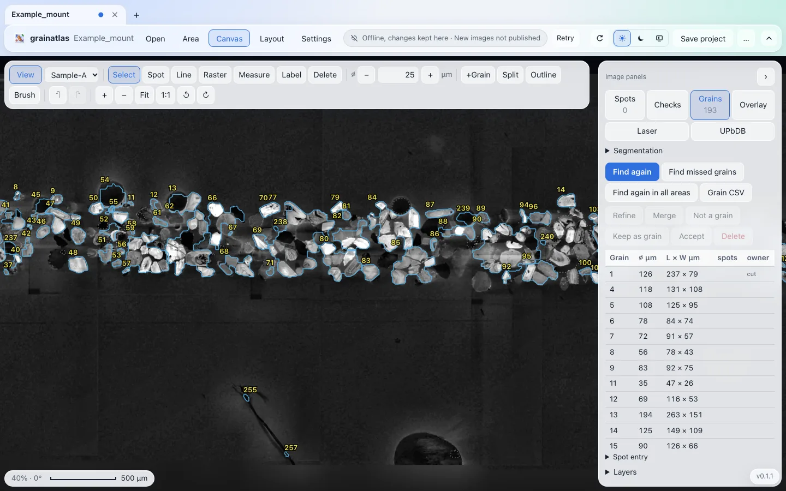
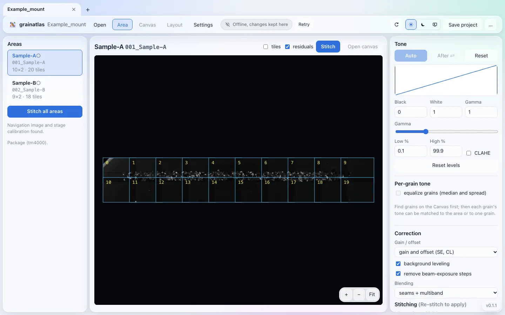
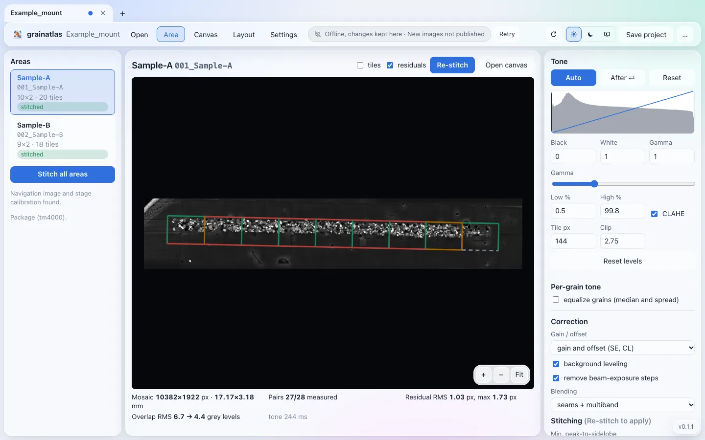
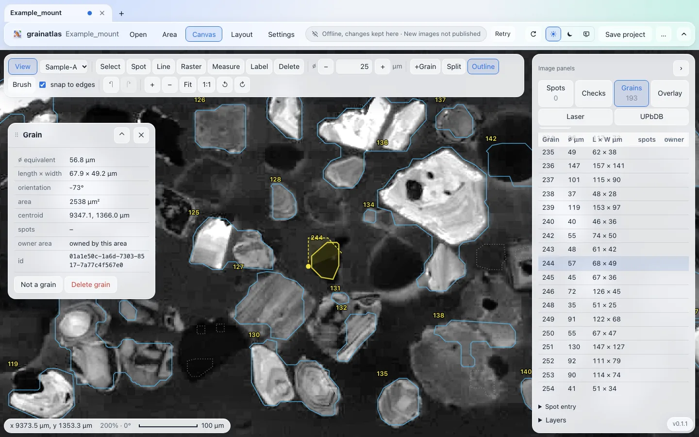
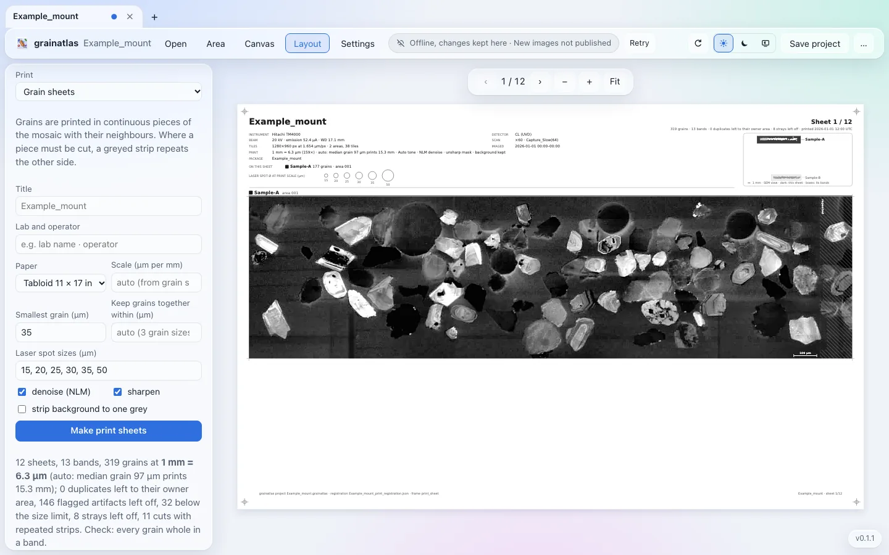
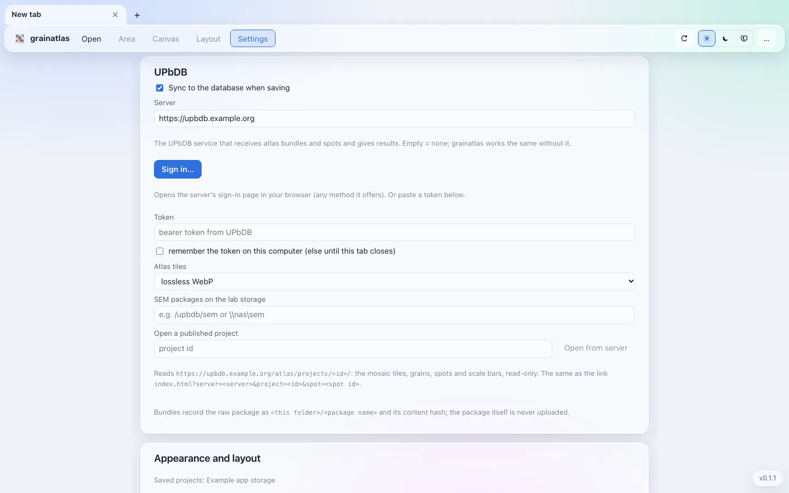

<p align="center"></p>

# GrainAtlas

Stitch, tone, segment, spot and print SEM grain-mount images (CL, BSE, SE) for
LA-ICP-MS sessions. The same interface runs as a macOS desktop app, in a
browser and inside UPb Lab; packages are read locally, with optional UPbDB sync.

[Docs site](https://duserzym.github.io/grainatlas/) · [Download](https://github.com/duserzym/grainatlas/releases/tag/v0.1.1) · [UPb Lab](https://github.com/duserzym/upblab) · [UPbRPy](https://github.com/duserzym/UPbRPy) · [UPbDB](https://github.com/duserzym/upbdb)

<picture>
  <source media="(prefers-color-scheme: dark)" srcset="docs/images/grains-1440x900-dark.webp">
  
</picture>

## Install

On **macOS with Apple silicon**, download `grainatlas_0.1.1_aarch64.dmg` from
[the latest release](https://github.com/duserzym/grainatlas/releases/latest),
open it and drag GrainAtlas to Applications.

The app is not notarized, so macOS blocks its first launch. Open it once,
then go to **System Settings → Privacy & Security → Open Anyway** on macOS 15
and later. On older macOS, Control-click the app and choose **Open**.

After that, the app updates itself. Click the version chip at the bottom
right, or open **Settings → Updates**, to check and download updates; choose
**Restart to update** when ready. See [In-app updates](docs/in-app-updates.md).

A Windows build is not yet published. A static browser build is available
with `make ui-build`; GrainAtlas also runs inside
[UPb Lab](https://github.com/duserzym/upblab).

## Workflow

### 1. Open a package

Drop a folder on the window, or choose one. grainatlas reads a TM4000 Zigzag
package (`.zag`, one subfolder per area), a single area folder, any folder of
images with a `positions.csv`, or loose images with a scale you type once.
Several packages or saved projects open as tabs.


<picture>
  <source media="(prefers-color-scheme: dark)" srcset="docs/images/open-1440x900-dark.webp">
  
</picture>

### 2. Stitch and tone

**Stitch all areas** places the tiles from the stage positions, refines every
overlap and solves the whole area at once (the residuals are shown on the
mosaic). Gain, offset, beam-exposure steps and background are corrected in
one solve. **Auto** sets the tone from the histogram; every control re-renders
the mosaic live, and **After ⇄** compares with the state before Auto.


<picture>
  <source media="(prefers-color-scheme: dark)" srcset="docs/images/stitch-1440x900-dark.webp">
  
</picture>

### 3. Find the grains

On the **Canvas**, **Grains → Find grains** outlines every grain. For CL,
choose "brighter or darker" so CL-dark zircons are found too. Epoxy bubbles,
tile-seam slivers, exposure blocks and specks are flagged rather than deleted:
they show dimmed with their reason, and one click keeps one as a grain.
Grains are numbered in reading order, stable across re-runs. Grains that a
neighbouring area also captured are dashed in that area's colour.


<picture>
  <source media="(prefers-color-scheme: dark)" srcset="docs/images/grains-1440x900-dark.webp">
  
</picture>

### 4. Make the final call by hand

You decide what a grain is.

| Tool | Key | What it does |
|------|-----|--------------|
| **Delete** | D | Click a grain to remove it. The grain card also has **Not a grain** and **Delete grain**. |
| **Outline** | O | Draw a lasso, freehand or click by click; it snaps to grain edges (hold ⌘ for no snap). Close it with a double-click, Enter or a click on the first point. A new outline replaces the grain under it; ⇧ adds to that grain, ⌥ cuts from it. |
| **Brush** | B | Paint a grain larger at a size in µm; ⌥ erases. |
| **+Grain**, **Split** | G, K | Add a grain at a click; split touching grains. |

**Find again** keeps the grains you drew, and ⌘Z undoes any edit.


<picture>
  <source media="(prefers-color-scheme: dark)" srcset="docs/images/outline-1440x900-dark.webp">
  
</picture>

### 5. Place spots

With the **Spot** tool (S), click a grain to place a laser spot. The size box
(toolbar and the side panel's **Spot entry**) sets the diameter: arrows step
1 µm (⇧ 5, ⌥ 0.5), typed values such as 40.5 are kept, keys 1–6 pick a preset.
Spots are named from a pattern, `{sample}_{n}` by default. Within a working
session `n` counts up across samples and areas, like an instrument run number;
Spot entry shows the next name and warns when it is already used. Type **Next
n** to start anywhere, or tick "restart at 1 for each sample". Drag a spot to
move it, drag its ring to resize it, and export the spots as CSV or GeoJSON.

Select several spots (or grains) to edit them together: ⌘-click toggles,
⇧-click selects a range in a table and adds on the canvas, ⇧-drag on empty
space draws a rectangle, ⌘A selects all in the area, Esc clears. The selection
then takes a new diameter, **Renumber…** (from a start number, in table,
placement or row order, with a preview and a check for names used twice),
**Sample or pattern…** or Delete, each one undo step.


<picture>
  <source media="(prefers-color-scheme: dark)" srcset="docs/images/spots-1440x900-dark.webp">
  
</picture>

### 6. Print sheets for the laser session

**Layout → Make print sheets** puts every grain of the mount on paper once, at
one scale (tabloid by default, with scale chosen from the grain sizes):

- Each sample is cut into bands straight out of the mosaic.
- Each sheet carries the instrument header, a mount map and the laser spot
  sizes at print scale.
- **Export PDF** writes the sheets; **Registration** saves the
  `print_registration.json` sidecar that maps every band back to the mosaic.

**Save project** (⌘S) writes a `.gaproj` next to the package, or back to the
`.gaproj` file or `.grainatlas` folder it came from.


After the session, UPbDB's results show on the spots. A fiducial fit maps
the mosaic to the laser stage and writes the spot list (see "UPbDB and the
laser" below).

<picture>
  <source media="(prefers-color-scheme: dark)" srcset="docs/images/print-1440x900-dark.webp">
  
</picture>

### 7. Sync with UPbDB

In **Settings → UPbDB**, set the server and choose **Sign in…** in the desktop
app. It opens the server's sign-in page in your browser and hands a one-time
code back to the app. Inside UPb Lab, the shell supplies the sign-in.

The sync chip in the top bar shows whether the project matches the database.
Click it for details, then register a project, sync local changes or review
differences as needed. This is optional; GrainAtlas works without a server.

<picture>
  <source media="(prefers-color-scheme: dark)" srcset="docs/images/settings-1440x900-dark.webp">
  
</picture>

<picture>
  <source media="(prefers-color-scheme: dark)" srcset="docs/images/sync-1440x900-dark.webp">
  
</picture>

## For developers

### Quick start

```bash
make setup        # Rust stable + wasm target, wasm-bindgen-cli, UI dependencies
make full         # Rust unit tests, svelte-check and the desktop crate
make ui-build     # static page in ui/dist (serve it from any static server)
make ui-dev       # dev server on http://localhost:5174
make desktop-dev  # desktop app (Tauri 2) on this machine
```

Sample data and the image-based test suite stay outside the public repository.
`make full` runs the Rust unit tests, type checks and a desktop compile.

One Rust core runs in a Web Worker through wasm in the static browser build,
and natively with multiple threads in the Tauri 2 desktop app. Both use the
same Svelte interface.

Development desktop builds use the separate `dev` browser storage profile by default.
Test bundles must be launched with `GRAINATLAS_PROFILE=test` or `--profile test`; named profiles keep localStorage separate and show their name in the window title (on macOS, separate stores require macOS 14 or later).
Release launches without a profile keep the normal app's existing storage.

CI: `ci`, `desktop` and `release` run on `v*` tags and by hand, never on
branch pushes or pull requests. They check out `upblab` alongside this
repository; a private checkout needs the read-only `UPBSTUDIO_TOKEN` secret.
`desktop` builds macOS and Windows installers and signed updates; `release`
builds the web archive. Tags attach assets to a draft release; manual runs
keep workflow artifacts. Pages is a separate, manual-only workflow.

### What it does, in detail

Status: roadmap phases 1–11 of `ARCHITECTURE_PLAN.md` are implemented (readers
and stitching, photometric correction, web UI, segmentation and scale, spots,
print layout, desktop, the UPbDB link, atlas bundles, results overlay and
laser registration), except a reader for a second instrument (phase 8, waiting
for example files) and an adapter for the lab's laser software (phase 11,
waiting for its name and an example file).

1. Opens a Hitachi TM4000 Zigzag package (`.zag`, UTF-16LE `.ini` and per-tile
   `.txt`, unknown keys kept), one TM4000 area folder on its own (scale and
   stage positions from its sidecars), any folder of images with
   `positions.csv` (`file,x_um,y_um,pixel_size_nm`), or loose images with a
   scale typed once (each image an area, or one grid); see ADR-0006.
2. Stitches by stage prior, phase correlation with a Lucas-Kanade refinement
   and a global least-squares solve; corrects per-tile gain and offset, beam
   exposure steps and background in one joint solve over all tiles (overlaps agree,
   background flat; `docs/stitch_notes.md`); blends with seams and multiband
   (photocraft-algo). The 4 x 8 example area (32 tiles, 28 Mpx) takes 0.6 s
   natively and 8 s in the browser; see `docs/stitch_notes.md`. Tone is one
   click (Auto: leveling, stretch, CLAHE from the histogram, with Before /
   After and Reset) or manual; every control re-renders the mosaic live, and
   after segmentation each grain's tone can be matched to the area or to one
   grain.
3. Finds and numbers grains (reading order, stable across re-runs), with
   GrabCut refinement and manual add, split, merge and renumber; hand editing
   with an edge-snapping lasso and a brush, kept across re-runs; scale bars
   per grain; grain table CSV. The artifact rules follow the image signal
   (CL or BSE, read from the TM4000 metadata, overridable in the Grains tab;
   `docs/print_sheets.md`). The Grains tab says when an area has never been
   segmented and finds grains in every area without grains in one click;
   `grainatlas segment <project> --missing` does the same from the command line.
   Find missed grains adds uncovered detections while keeping existing outlines,
   numbers and spot links. New outlines are dashed until accepted; one undo
   restores the whole action. The CLI equivalent is
   `grainatlas segment <project> --add-missing [--area ID]... [--signal auto|cl|bse] [--dry-run]`.
   It requires an existing grain list and cannot be combined with `--missing`.
4. Places laser spots, lines and rasters on an infinite canvas with the mouse
   or trackpad alone (click to place, drag to move, drag the ring to resize,
   double-click to rename), named from a pattern, `{sample}_{n}` by default (n continues across
   samples within a session, or per sample when chosen), with UUIDv7 ids;
   batch edits of the selection; exports CSV and GeoJSON.
5. Packs grains or areas onto Letter, Tabloid, A4 or A3 pages with labels,
   scale bars, spots and cut marks; exports PDF and SVG.
6. Registers reference images (photos of annotated printouts, post-laser
   frames) to the mosaic by point pairs, to recover spots of legacy sessions
   (`docs/legacy_workflow.md`).
7. Writes **atlas bundles** (`upblab/docs/WORKFLOW.md` section 3.1) and
   publishes them to UPbDB; opens published ones from a server; shows
   UPbDB's results on the spots; registers the laser stage and writes the
   spot list (see "UPbDB and the laser" below).

### Re-render saved areas

`grainatlas rerender <project.grainatlas>` re-runs photometric correction,
blend and tone from each area's saved placement and parameters. It requires
the original package at the saved path. Repeat `--area ID` to select areas.
`--background keep` (the default) uses the saved settings; `on` enables joint
background correction and `off` disables background correction. `--dry-run`
computes the JSON report without writing files. Without `--area`, areas with
no saved placement are skipped with a note on stderr and in the report. An
explicitly selected area without a placement is an error.

Save and close the project in the app before running rerender. The command
refuses to install results if project.json's modification time or size has
changed since it started. The app writes no on-disk open-project lock or
marker, so rerender cannot detect an open project that has not been saved.
The app's next save of a project that was open during a rerender would write
old photometric metadata. Reopen the project after rerender finishes.

The command keeps geometry, grains, spots and annotations unchanged. It
replaces the selected mosaic pyramids and photometric results, and saves
the originals as `project.before-rerender.YYYY-MM-DD_HHMM.json` and
`mosaic.before-rerender.YYYY-MM-DD_HHMM/<area>/` (UTC). An existing backup
for that minute is never overwritten. The JSON report includes elapsed
seconds, overlap RMS before and after correction, and grain and spot counts.

After a crash mid-install, keep the app closed and use backups with the same
stamp to recover by hand. Copy `project.before-rerender.STAMP.json` over
`project.json`. For every area folder present in
`mosaic.before-rerender.STAMP/`, move any replacement `mosaic/<area>/` aside,
then move the backed-up folder back to `mosaic/<area>/`. Leave areas absent
from that backup alone; they were not moved. Keep the backups until the
restored project opens correctly.

### Dependencies: `@lab/bridge`

grainatlas runs on its own and as the Images tab of UPb Lab. It talks to
the shell through `@lab/bridge`, which is not on npm yet: `ui/package.json`
depends on a sibling checkout, `"@lab/bridge": "file:../../upblab/bridge"`
(paths from `ui/`), so clone `upblab` next to `grainatlas`. `make setup`
builds `../upblab/bridge/dist` if it is missing (`make bridge`), before
`pnpm install`. CI checks out both repositories side by side
(`duserzym/upblab`; a private one needs a read-only `UPBSTUDIO_TOKEN`
secret).

Without an `upblab` checkout, take the bridge tarball from someone who has
one (`pnpm --filter @lab/bridge pack` in `upbstudio` writes
`lab-bridge-<version>.tgz`) and point the dependency at it, locally only:

```bash
cd ui && pnpm add ./lab-bridge-0.1.0.tgz
```

### Inside UPb Lab

- Hosted (the bridge's `isHosted()`), grainatlas uses the wasm core and the
  web file paths (`<input type=file webkitdirectory>`, drag-drop), even though
  Tauri's globals are present in the shell's webview.
- `index.html?project=<id>&spot=<id>` (the shell's mapping of
  `grainatlas://project/<id>/spot/<id>`) opens that project, selects the spot
  and centers the canvas on it. The browser keeps projects without pixels, so
  the package folder is opened again.
- A spot's panel has "Open in UPbDB" (`upbdb://acquisition/<id>` when
  the spot has an acquisition id, else `upbdb://search?label=<name>`);
  selecting a spot sends `lab.spot.selected` with `{project, spot, name,
  grain, area, via}`. `grain` is `<area_id>/<grain_number>` or null; `via` is
  `shell` for a command's selection until the user selects something else,
  otherwise `user`.
- Bridge v3 commands arrive through `onCommand`: `focus-spot {project, spot,
  flash?, via?, server?}` and `focus-grain {project, grain, spot?, flash?,
  via?, server?}`. They activate an open project tab, or open a published atlas
  read-only from the HTTP(S) server (the command's, else the page's server or
  Settings); otherwise they wait for the SEM package on Open. A grain may be
  its id, `<area_id>/<number>`, or an unambiguous number (qualified by the
  spot's area when supplied). Focus centres the canvas and highlights for
  about 1.5 s, unless `flash: false`; reduced motion uses a static highlight.
- A project folder offered by the shell keeps its `project.json` pending and
  names the SEM package to open. The next matching package loads that project
  automatically; an already open matching package loads it immediately, asking
  before replacing a different dirty project. `grainatlas.files.opened`
  reports `waiting: package <name>` and then `opened: project <name>`.
- "Send spots to UPbDB" on the Spots tab posts the spots with the shell's
  `token()` when a server and a mount are set, else downloads the JSON body of
  UPbDB's `POST /v1/mounts/{mount_id}/spots`.
- Storage keys all start with `grainatlas.` (the desktop shell shares one
  origin between its pages).

See `docs/decisions/ADR-0005-hosted-module.md`.

### UPbDB and the laser

All of this is optional; without a server grainatlas works as before.

- **Settings → UPbDB**: the server (`http://host:8000`) and, in the
  standalone desktop app, **Sign in…**: it opens the server's sign-in page
  in the browser (password, ORCID, Google or GitHub, whatever the server
  offers), the person confirms, and the browser hands a one-time code back to
  the app on `127.0.0.1` (RFC 8252 loopback; UPbDB's `#/connect` page). A
  pasted token still works; the static browser build uses token entry.
  Inside UPb Lab the shell's sign-in is used. Settings also holds
  the atlas tile quality (lossless WebP, or near-lossless at 97 or 92) and the
  folder where SEM packages live on the lab storage. A `?server=` in the page
  address wins for that page load; served by UPbDB under `/atlas/`,
  grainatlas uses its own origin.
- **Atlas bundle** (Canvas → UPbDB tab): `<project_id>.atlas/` with
  `atlas.json` (format `grainatlas-atlas` v1, ids, mount, scale, areas and
  levels, the raw package's content hash and storage path, sha256 and size of
  every file), `pyramid/<area>/<z>/<x>_<y>.webp` (256 px tiles, z = 0 full
  resolution), `grains.geojson`, `spots.json`, `scalebars.json` and
  `project.json`. Save it as a folder (desktop, or Chromium) or a zip, or
  **Publish** it: a multipart `POST /v1/mounts/{mount}/atlas` (field
  `bundle`); each publish is recorded in `project.json`
  (`upbdb.published`). The mount comes from `GET /v1/mounts` when the
  server answers, else it is typed. `grainatlas atlas <package> --out <dir or
  .zip>` writes the same bundle from the command line, and native and browser
  builds write identical bytes.
- **Open from server**: `index.html?server=<base>&project=<id>[&spot=<id>]`
  (`&mount=<id>&access=<token>` in UPbDB's own viewer links, enough for
  the files and the mount's results without signing in),
  or Settings → "Open a published project", reads
  `<base>/atlas/projects/<id>/` and shows the bundle read-only (tiles straight
  from the server, nothing stitched). **Edit a copy** makes it a local
  project with the same id; opening the raw package later picks it up.
- **Results**: with a server and a linked mount, `GET /v1/mounts/{id}/results`
  fills the spot panel (preferred date ± 2σ, ratios, concentrations, flags,
  "Open acquisition") and a coloured results layer with a legend. Results are
  never saved in the project.
- **Laser** (Canvas → Laser tab): three or more fiducial spots with the stage
  coordinates read off the laser give an affine map (least squares, residuals
  in µm, a warning above 5 µm); "Export spot list" writes the generic CSV in
  the laser's units. Adding the lab's laser software: `docs/laser-adapters.md`.

### Updates

The version chip stays in the bottom-right corner, including on the Canvas.
It shows when an update is available or ready; click it to open Settings >
Updates. Use **Check now** to check explicitly, choose Stable or Beta
(pre-releases), and turn automatic downloads on or off. A downloaded update
waits for **Restart to update**. UPb Lab updates hosted copies with its shell.

One-time owner setup (generates the signing key, writes the public key, and
sets `TAURI_SIGNING_PRIVATE_KEY` with `gh` when signed in):

```bash
make updater-setup
make check-version
```

Back up `~/.tauri/grainatlas-updater.key`. The `desktop` workflow now publishes
a draft release with installers, signed update bundles and `latest.json` on
`v*` tags; manual runs keep workflow artifacts. Publish the draft after the
workflows pass. See [In-app updates](docs/in-app-updates.md) for setup and channels.

### Release asset for UPb Lab

```bash
make release-web
```

builds `ui/dist` and packs it as
`target/release-web/grainatlas-web-<version>.tar.gz` (`index.html` at the top,
`<version>` from `ui/package.json`), printing its SHA-256 and writing it to
`grainatlas-web-<version>.tar.gz.sha256`. Pushing a tag `v<version>` runs
`.github/workflows/release.yml`, which builds the same archive on
`ubuntu-latest` and attaches it and the `.sha256` to a draft release. For
`upbstudio/modules.lock.json`:

- `url`: `https://github.com/duserzym/grainatlas/releases/download/v<version>/grainatlas-web-<version>.tar.gz`
- `sha256`: of the downloaded asset, from
  `shasum -a 256 grainatlas-web-<version>.tar.gz` (macOS),
  `sha256sum grainatlas-web-<version>.tar.gz` (Linux) or
  `Get-FileHash -Algorithm SHA256 grainatlas-web-<version>.tar.gz` (Windows
  PowerShell; lower-case it). Use the hash of the published file, or the
  `.sha256` next to it: a local `make release-web` packs different bytes.

### Command line

The command line does batch work:

```bash
cargo run --release -p grainatlas-cli -- stitch <package-or-area-folder> --out <name>.grainatlas --auto --polarity both --print tabloid
```

`--print tabloid` writes print sheets for hand spot registration: every grain of
the package once (cross-area duplicates go to their owner area), at a scale chosen
from the grain sizes (median grain about 15 mm on paper; `--scale 8` fixes it),
with the `print_sheet` registration sidecar. Sheets follow the layout rule
"context first": grains are printed in continuous pieces of the mosaic with their
neighbours, and where a piece must be cut a hatched strip repeats the other side.
`--print-style grains` gives the older per-area layout of single grains cropped
alone, only when asked for by name. `grainatlas sheets <name>.grainatlas --out <dir>`
prints the sheets of a saved project again without stitching. See
[docs/print_sheets.md](docs/print_sheets.md).

The desktop app also takes `grainatlas <package-or-area-folder> [--stitch] [--segment]`
or `grainatlas <images…> --um-per-px <µm> | --field-um <µm> [--stitch]`, and
opens saved `<name>.grainatlas` folders and `<name>.gaproj` project files.

#### Tabs and project files

One window holds several projects as tabs (desktop and web): **+** or Cmd/Ctrl+T for a new
tab, × or Cmd/Ctrl+W to close (a dot marks unsaved changes and closing asks), Cmd/Ctrl+1..9
and Ctrl+Tab to switch, drag to reorder. Each tab has its own session (package, mosaics,
grains, spots, undo); a stitch keeps running in its tab while you work in another. Opening
or dropping something while a project is open makes a new tab; several folders on the
command line open one tab each:

```bash
open -a grainatlas --args A.grainatlas B.grainatlas C.gaproj --stitch
```

**Save project** (Cmd/Ctrl+S) writes `<name>.gaproj` next to the package, or back to the
`.gaproj` file or `.grainatlas` folder the tab came from; **Save as…** writes a `.gaproj`
where you choose. A `.gaproj` is the project record alone (parameters, solved placements,
photometric results, grains, spots, labels, the UPbDB link; about 1-2 MB, no pixels).
Double-clicking one opens it as a tab: the package's own images are read from the recorded
path and every stitched area is rendered from its saved placement, without stitching again
(`--stitch` stitches only areas that have none). In the web build Save downloads the
`.gaproj`, and the Open screen's Project file loads one onto an opened package.

### Layout

```text
crates/grainatlas-core   all pixel operations (readers, mosaic, photometric, blend, segment, scale, spots, layout, project, atlas, laser)
crates/grainatlas-wasm   the core for the browser (wasm-bindgen)
crates/grainatlas-cli    `grainatlas` command line
ui/                    Svelte 5 + TypeScript + Vite; src/lib/core/{wasm,tauri}.ts implement the Core interface
tauri/                 Tauri 2 desktop shell (src-tauri)
docs/                  ADRs, stitch notes, legacy workflow, UX conventions, laser adapters
site/                  project website (static, no build step)
```

The repository holds no sample data or test fixtures. The screenshots in
`docs/images/` are the only images from real mounts, with all names and metadata
removed; see [Screenshot policy](docs/screenshots.md). `docs/app-blank.png`
shows the app before anything opens.

The project website lives in `site/` (`make site` assembles it in
`target/site`); it is published to GitHub Pages only by running the Pages
workflow by hand.

License: MIT. Image algorithms reused from
[storytold/photocraft](https://github.com/storytold/photocraft) (MIT OR
Apache-2.0) and the lossless WebP encoder of
[image-rs/image-webp](https://github.com/image-rs/image-webp) (MIT OR
Apache-2.0); see `ATTRIBUTION.md`.

### Opened from UPb Lab

UPb Lab launches the installed standalone app with a one-time sign-in code:

```sh
open -n -b org.grainatlas.desktop --args --project <uuid> --server <base-url> --code <one-time-code> [--revision <n>]
```

A normal second launch forwards its arguments to the running instance, focuses
its window and exits. Launches with `--profile <dir>` (and development or named
profiles) skip single-instance forwarding and keep their separate storage.
`grainatlas://` links remain owned by UPb Lab.

GrainAtlas compares normalized server addresses. A different server asks
“Open project from <host>? This is not your configured server.” Nothing is
fetched from that server before confirmation. It then immediately exchanges
`{code}` at `POST /v1/auth/exchange`, reads `{token, account}`, and keeps the
token in memory for this session. The code is never saved or logged; Rust
Debug output redacts it. Do not pass a bearer token on the command line.

The project opens in View with its current mount revision. `--revision` is
the shell's observed revision; the app checks the database's current state
rather than reconstructing historical images. A locally held draft with the
same uuid opens in Edit and the chip says “Your draft here, based on r<n>”.
Hosted and standalone storage are separate; drafts are not transferred by
the launch arguments.
