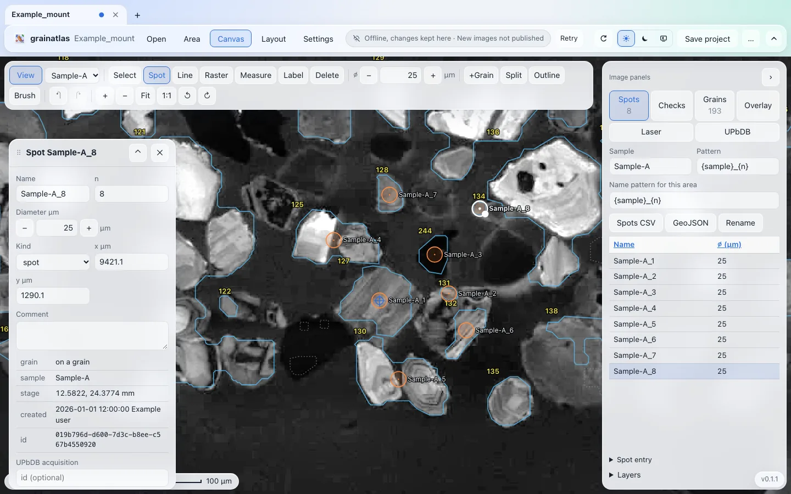
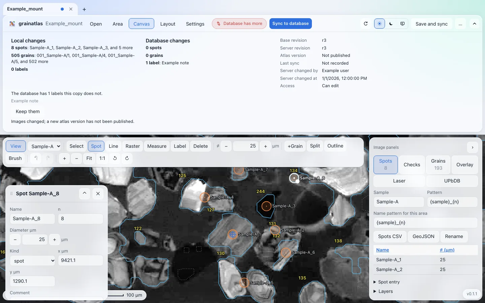

<p align="center">
  
</p>

<h1 align="center">GrainAtlas</h1>

<p align="center">Stitch, segment, spot and print SEM images of grain mounts for LA-ICP-MS</p>

<p align="center">
  <a href="https://github.com/duserzym/grainatlas/releases/latest">Download</a> ·
  <a href="https://duserzym.github.io/grainatlas/">Manual</a> ·
  <a href="https://github.com/duserzym/upblab">UPb Lab</a> ·
  <a href="https://github.com/duserzym/UPbRPy">UPbRPy</a> ·
  <a href="https://github.com/duserzym/upb-standards">upb-standards</a>
</p>

<picture>
  <source media="(prefers-color-scheme: dark)" srcset="docs/images/grains-1440x900-dark.webp">
  
</picture>

GrainAtlas prepares SEM grain-mount images for LA-ICP-MS sessions, from tiles
to laser spots and printed sheets. It is for geochronology labs working with
CL, BSE and SE images. The same interface runs on macOS, in a browser and
inside UPb Lab. Packages are read locally, with optional UPbDB sync.

## Features

### Open a package

Open TM4000 Zigzag packages (`.zag`), single area folders, image folders with
`positions.csv`, or loose images with a scale you enter once.
Drop a folder on the window or choose one; several packages or saved projects
open as tabs.

<picture>
  <source media="(prefers-color-scheme: dark)" srcset="docs/images/open-1440x900-dark.webp">
  
</picture>

### Stitch and tone

**Stitch all areas** aligns tiles from stage positions, refines overlaps and
corrects gain, offset, beam-exposure steps and background in one solve.
**Auto** sets tone from the histogram; controls update the mosaic live, and
**After ⇄** compares it with the state before Auto.

<picture>
  <source media="(prefers-color-scheme: dark)" srcset="docs/images/stitch-1440x900-dark.webp">
  
</picture>

### Find and edit grains

**Find grains** numbers outlines and keeps flagged artefacts dimmed;
**Outline**, **Brush** and **Split** refine grains by hand.
**Find again** keeps hand edits, and ⌘Z undoes changes; see the
[canvas manual](https://duserzym.github.io/grainatlas/canvas.html) for keyboard
tools, spot numbering and batch edits.

<picture>
  <source media="(prefers-color-scheme: dark)" srcset="docs/images/outline-1440x900-dark.webp">
  
</picture>

### Place spots

Choose **Spot** to place laser spots, set their diameter in µm and name them
from a pattern, such as `{sample}_{n}`.
Drag spots to move them or their rings to resize them, then export CSV or GeoJSON.

<picture>
  <source media="(prefers-color-scheme: dark)" srcset="docs/images/spots-1440x900-dark.webp">
  
</picture>

### Print sheets

**Make print sheets** keeps neighbouring grains together at one scale, with
an instrument header, mount map and spot sizes; export PDF and registration sidecars.
Pack sheets onto fewer pages and edit the strips by hand before printing.
**Save project** (⌘S) writes a `.gaproj` beside the package, or saves back to
the project file or `.grainatlas` folder it came from.

<picture>
  <source media="(prefers-color-scheme: dark)" srcset="docs/images/print-1440x900-dark.webp">
  
</picture>

### Sync with UPbDB

Sync is optional. Sign in from **Settings → UPbDB**, then use the sync chip to
register a project, send local changes or review differences. Inside UPb Lab, the
shell supplies the sign-in. With a server, stored results show on the spots, and
the Laser panel maps the mosaic to the laser stage to export a spot list.

<picture>
  <source media="(prefers-color-scheme: dark)" srcset="docs/images/sync-1440x900-dark.webp">
  
</picture>

## Install

On macOS with Apple silicon, download the `.dmg` from the
[latest release](https://github.com/duserzym/grainatlas/releases/latest)
(`grainatlas_<version>_aarch64.dmg`) and drag GrainAtlas to Applications.
The app is not notarized: launch it once, then choose
**System Settings → Privacy & Security → Open Anyway** on macOS 15 or later.
On older macOS, Control-click the app and choose **Open**.

Use the version chip or **Settings → Updates** to check for in-app updates,
choose Stable or Beta, and control automatic downloads.
Choose **Restart to update** when ready; see [In-app updates](docs/in-app-updates.md).

A Windows build is not yet published. Build a static browser version with
`make ui-build`, or the desktop app with `make desktop-build` after the developer
quick start below. GrainAtlas also runs inside UPb Lab.

## Related apps

- **[UPb Lab](https://github.com/duserzym/upblab)**: one window for the lab workflow: sessions, images and review of stored results.
- **[UPbRPy](https://github.com/duserzym/UPbRPy)**: data reduction engine and desktop Studio for LA-ICP-MS U-Pb and trace elements.
- **[upb-standards](https://github.com/duserzym/upb-standards)**: reference-material values with full citations, used by UPbRPy.
- **UPbDB**: the lab database server for sessions, spots and stored reductions (private).

## For developers

Clone [UPb Lab](https://github.com/duserzym/upblab) next to this repository;
its `bridge` supplies `@lab/bridge`, which is not on npm yet.

```bash
make setup        # Rust stable + wasm target, wasm-bindgen-cli, UI dependencies
make full         # Rust unit tests, svelte-check and the desktop crate
make ui-build     # static page in ui/dist (serve it from any static server)
make ui-dev       # dev server on http://localhost:5174
make desktop-dev  # desktop app (Tauri 2) on this machine
```

One Rust core runs as wasm in the browser and natively in the Tauri 2 desktop
app, with the same Svelte UI. See [Developing GrainAtlas](docs/developing.md)
for architecture, storage profiles, CLI commands, integration and releases.

## License

MIT. Image algorithms reuse [photocraft](https://github.com/storytold/photocraft) and the lossless WebP encoder from [image-webp](https://github.com/image-rs/image-webp), both MIT OR Apache-2.0; see [ATTRIBUTION.md](ATTRIBUTION.md).
